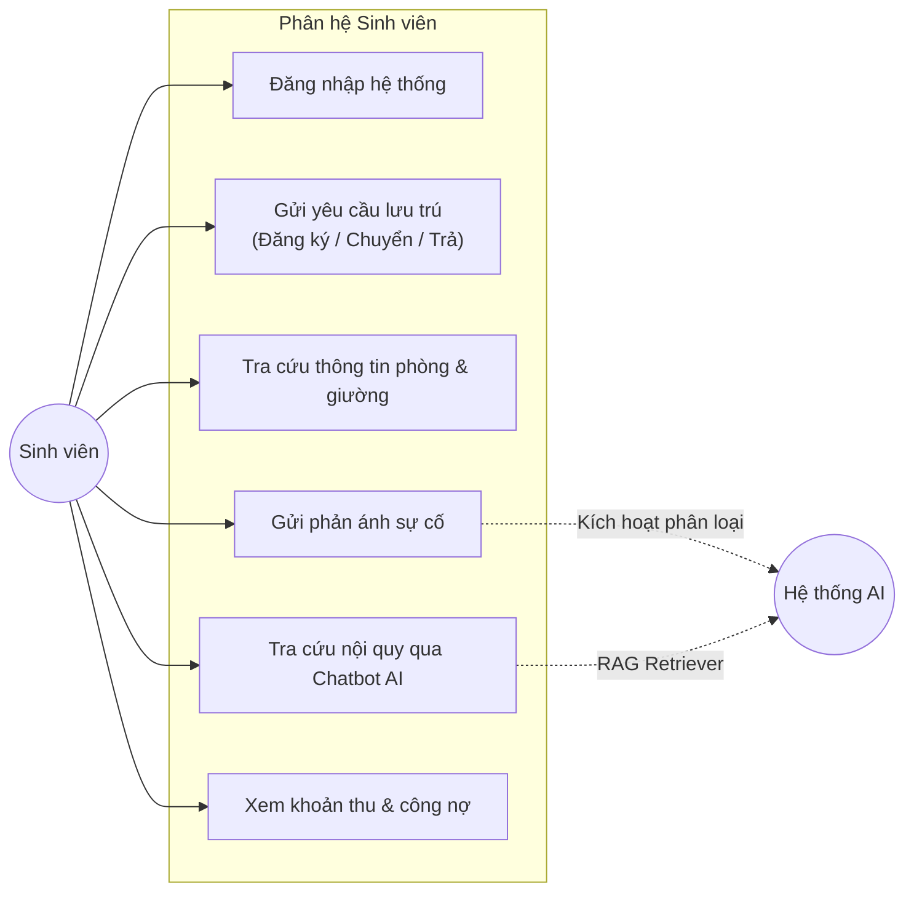
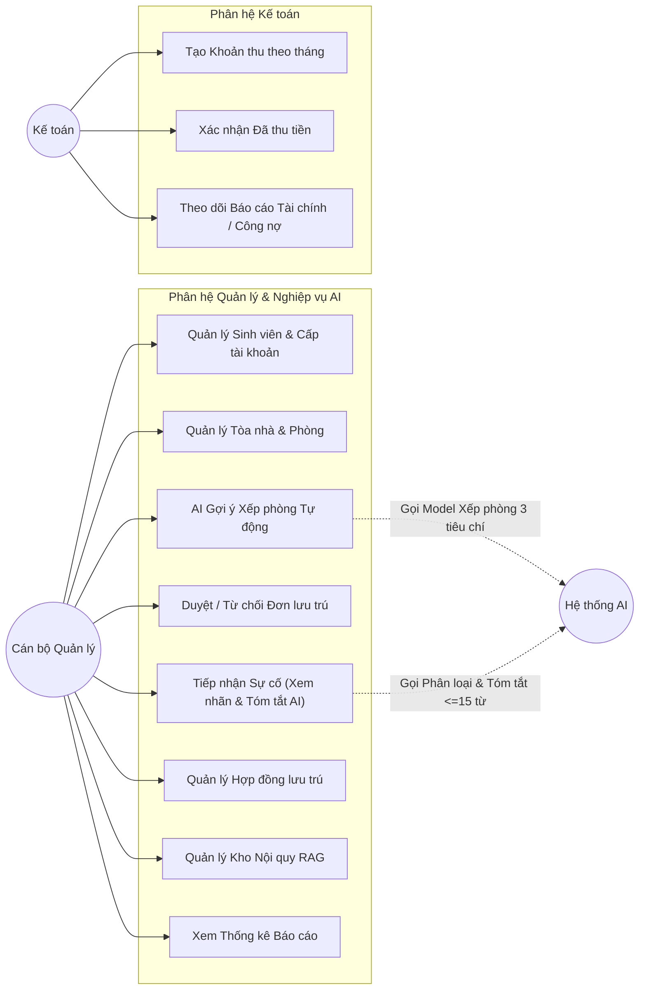
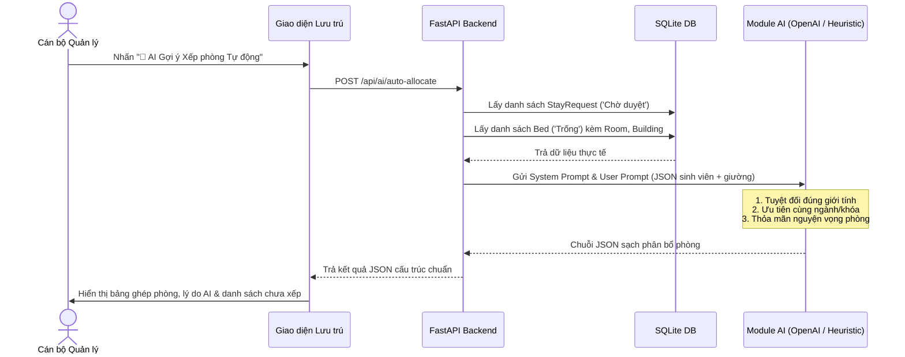

# TÀI LIỆU ĐẶC TẢ KỊCH BẢN USE CASE (USE CASE SPECIFICATION)
## HỆ THỐNG QUẢN LÝ KÝ TÚC XÁ THÔNG MINH TÍCH HỢP AI (KTX-AI)

**Học phần:** Ứng dụng Trí tuệ Nhân tạo  
**Dự án:** KTX-AI / KTX-ICTU  
**Phiên bản:** 1.0  
**Ngày cập nhật:** Tháng 10/2026  

---

## MỤC LỤC
1. [Giới thiệu & Tổng quan Hệ thống](#1-giới-thiệu--tổng-quan-hệ-thống)
2. [Xác định các Tác nhân (Actors)](#2-xác-định-các-tác-nhân-actors)
3. [Sơ đồ Use Case Tổng thể (Use Case Diagrams)](#3-sơ-đồ-use-case-tổng-thể-use-case-diagrams)
4. [Danh mục Use Case Hệ thống](#4-danh-mục-use-case-hệ-thống)
5. [Đặc tả Chi tiết Kịch bản Use Case Chính](#5-đặc-tả-chi-tiết-kịch-bản-use-case-chính)
   - [UC-01: Đăng nhập & Phân quyền Hệ thống](#uc-01-đăng-nhập--phân-quyền-hệ-thống)
   - [UC-02: Sinh viên Gửi Yêu cầu Lưu trú](#uc-02-sinh-viên-gửi-yêu-cầu-lưu-trú)
   - [UC-03: Chatbot AI Tra cứu Nội quy KTX (RAG)](#uc-03-chatbot-ai-tra-cứu-nội-quy-ktx-rag)
   - [UC-04: Sinh viên Gửi Phản ánh / Báo cáo Sự cố](#uc-04-sinh-viên-gửi-phản-ánh--báo-cáo-sự-cố)
   - [UC-05: AI Gợi ý Xếp phòng Tự động theo 3 Nguyên tắc (Core AI 1)](#uc-05-ai-gợi-ý-xếp-phòng-tự-động-theo-3-nguyên-tắc-core-ai-1)
   - [UC-06: Cán bộ Quản lý Duyệt Đơn Lưu trú & Cập nhật Giường](#uc-06-cán-bộ-quản-lý-duyệt-đơn-lưu-trú--cập-nhật-giường)
   - [UC-07: AI Phân loại & Tóm tắt Sự cố Tự động (Core AI 2)](#uc-07-ai-phân-loại--tóm-tắt-sự-cố-tự-động-core-ai-2)
   - [UC-08: Quản lý Xử lý Sự cố & Cập nhật Tiến độ](#uc-08-quản-lý-xử-lý-sự-cố--cập-nhật-tiến-độ)
   - [UC-09: Quản lý Hạ tầng KTX (Tòa nhà, Phòng, Giường)](#uc-09-quản-lý-hạ-tầng-ktx-tòa-nhà-phòng-giường)
   - [UC-10: Quản lý Hồ sơ Sinh viên & Cấp Tài khoản](#uc-10-quản-lý-hồ-sơ-sinh-viên--cấp-tài-khoản)
   - [UC-11: Quản trị Kho Tri thức Nội quy (Knowledge Base)](#uc-11-quản-trị-kho-tri-thức-nội-quy-knowledge-base)
   - [UC-12: Quản lý Thu phí & Xác nhận Thanh toán Tài chính](#uc-12-quản-lý-thu-phí--xác-nhận-thanh-toán-tài-chính)
   - [UC-13: Xem Thống kê & Báo cáo Tổng hợp](#uc-13-xem-thống-kê--báo-cáo-tổng-hợp)
6. [Ma trận Truy xuất Yêu cầu (Traceability Matrix)](#6-ma-trận-truy-xuất-yêu-cầu-traceability-matrix)

---

## 1. GIỚI THIỆU & TỔNG QUAN HỆ THỐNG

Hệ thống **KTX-AI** là nền tảng quản lý ký túc xá thông minh, kết hợp hài hòa giữa các chức năng nghiệp vụ quản lý truyền thống (phòng, giường, sinh viên, hợp đồng, tài chính) và các năng lực trí tuệ nhân tạo hiện đại:
1. **AI Ghép phòng Tối ưu:** Tự động đề xuất phân bổ giường cho sinh viên dựa trên phân tầng 3 nguyên tắc: Tuyệt đối đúng giới tính $\rightarrow$ Cùng ngành/khóa $\rightarrow$ Thỏa mãn nguyện vọng loại phòng.
2. **AI Phân loại & Tóm tắt Sự cố:** Tự động đọc văn bản mô tả phản ánh từ sinh viên, gán nhãn cố định vào 1 trong 5 nhóm (`Điện`, `Nước`, `Cơ sở vật chất`, `An ninh`, `Khác`) và tạo câu tóm tắt kỹ thuật ngắn gọn không quá 15 từ nêu rõ bản chất và vị trí.
3. **Chatbot RAG Nội quy:** Trợ lý ảo trả lời thắc mắc của sinh viên dựa trên kho dữ liệu nội quy chính xác, có trích dẫn nguồn điều khoản, tránh ảo giác thông tin.

---

## 2. XÁC ĐỊNH CÁC TÁC NHÂN (ACTORS)

| Tác nhân (Actor) | Bản chất | Mô tả vai trò & Trách nhiệm |
|---|---|---|
| **Sinh viên (Student)** | Người dùng cuối (Human) | Sinh viên nội trú hoặc có nhu cầu ở KTX. Sử dụng hệ thống để đăng ký lưu trú, xem phòng/giường, gửi phản ánh sự cố, tra cứu công nợ phí và tương tác với Chatbot AI nội quy. |
| **Cán bộ Quản lý (Dorm Manager)** | Người dùng quản trị (Human) | Quản lý tòa nhà, phòng, tiếp nhận và duyệt đơn lưu trú, sử dụng tính năng **AI Gợi ý Xếp phòng Tự động**, tiếp nhận sự cố được **AI phân loại & tóm tắt**, quản lý hợp đồng và nội quy. |
| **Kế toán (Accountant)** | Người dùng nghiệp vụ (Human) | Quản lý danh mục khoản thu phí KTX, lập phiếu thu theo tháng, theo dõi công nợ sinh viên và xác nhận thanh toán khi sinh viên hoàn thành nghĩa vụ. |
| **Dịch vụ AI (AI Service)** | Tác nhân hệ thống (System) | Module tích hợp mô hình ngôn ngữ lớn (OpenAI GPT-4o-mini / Gemini / Fallback Algorithm). Tiếp nhận Prompt và trả về chuỗi JSON có cấu trúc phục vụ xếp phòng, tóm tắt sự cố và truy hồi RAG. |

---

## 3. SƠ ĐỒ USE CASE TỔNG THỂ (USE CASE DIAGRAMS)

### 3.1. Sơ đồ Phân hệ Sinh viên & Dịch vụ AI

### 3.2. Sơ đồ Phân hệ Cán bộ Quản lý & Kế toán

---

## 4. DANH MỤC USE CASE HỆ THỐNG

| Mã Use Case | Tên Use Case | Tác nhân chính | Mức độ ưu tiên | Tích hợp AI |
|---|---|---|---|---|
| **UC-01** | Đăng nhập & Xác thực JWT | Sinh viên, Quản lý, Kế toán | Bắt buộc | Không |
| **UC-02** | Gửi Yêu cầu Lưu trú | Sinh viên | Bắt buộc | Không |
| **UC-03** | Chatbot AI Tra cứu Nội quy KTX | Sinh viên | Cao | **Có (RAG)** |
| **UC-04** | Gửi Phản ánh / Báo cáo Sự cố | Sinh viên | Bắt buộc | Không |
| **UC-05** | **AI Gợi ý Xếp phòng Tự động** | Cán bộ Quản lý | Cao | **Có (Core AI 1)** |
| **UC-06** | Phê duyệt Đơn Lưu trú & Cập nhật Giường | Cán bộ Quản lý | Bắt buộc | Không |
| **UC-07** | **AI Phân loại & Tóm tắt Sự cố** | Cán bộ Quản lý, Hệ thống | Cao | **Có (Core AI 2)** |
| **UC-08** | Cập nhật Tiến độ Xử lý Sự cố | Cán bộ Quản lý | Bắt buộc | Không |
| **UC-09** | Quản lý Tòa nhà, Phòng & Giường | Cán bộ Quản lý | Bắt buộc | Không |
| **UC-10** | Quản lý Hồ sơ Sinh viên & Cấp Tài khoản | Cán bộ Quản lý | Bắt buộc | Không |
| **UC-11** | Quản trị Kho Tri thức Nội quy | Cán bộ Quản lý | Trung bình | Không |
| **UC-12** | Quản lý Thu phí & Thanh toán | Kế toán, Quản lý | Bắt buộc | Không |
| **UC-13** | Xem Báo cáo & Thống kê Tổng hợp | Cán bộ Quản lý, Kế toán | Trung bình | Không |

---

## 5. ĐẶC TẢ CHI TIẾT KỊCH BẢN USE CASE CHÍNH

---

### UC-01: Đăng nhập & Phân quyền Hệ thống

- **Mã Use Case:** `UC-01`
- **Tác nhân chính:** Sinh viên, Cán bộ Quản lý, Kế toán
- **Mô tả ngắn:** Người dùng nhập thông tin xác thực để truy cập vào phân hệ chức năng tương ứng theo vai trò (Role).
- **Tiền điều kiện:** Người dùng đã có tài khoản trong bảng `users` và trạng thái `active = true`.
- **Hậu điều kiện:** Hệ thống cấp mã Token JWT lưu tại `localStorage`, chuyển hướng tới Dashboard tương ứng (`/sinhvien/`, `/quanly/`, `/ketoan/`).
- **Luồng sự kiện chính (Happy Path):**
  1. Người dùng mở trang đăng nhập (`/index.html`).
  2. Người dùng nhập tên đăng nhập (`username`) và mật khẩu (`password`).
  3. Người dùng nhấn nút **"Đăng nhập"**.
  4. Hệ thống gửi yêu cầu `POST /api/auth/login`.
  5. Hệ thống xác minh mật khẩu băm (Argon2), sinh JWT Token chứa định danh và `role`.
  6. Giao diện nhận Token, lưu vào bộ nhớ trình duyệt và điều hướng tới trang chủ tương ứng:
     - `sinhvien` $\rightarrow$ `/sinhvien/home.html`
     - `quanly` $\rightarrow$ `/quanly/home.html`
     - `ketoan` $\rightarrow$ `/ketoan/home.html`
- **Luồng ngoại lệ (Exceptions):**
  - *Sai thông tin đăng nhập:* Hệ thống trả mã lỗi `401 Unauthorized` kèm thông báo *"Tên đăng nhập hoặc mật khẩu không đúng"*.
  - *Tài khoản bị khóa:* Trả lỗi `403 Forbidden` *"Tài khoản đã bị vô hiệu hóa"*.

---

### UC-02: Sinh viên Gửi Yêu cầu Lưu trú

- **Mã Use Case:** `UC-02`
- **Tác nhân chính:** Sinh viên
- **Mô tả ngắn:** Sinh viên nộp đơn xin đăng ký vào KTX, xin chuyển đổi phòng ở hoặc xin trả phòng trước/hết hạn hợp đồng.
- **Tiền điều kiện:** Sinh viên đã đăng nhập thành công vào hệ thống.
- **Hậu điều kiện:** Một bản ghi mới được tạo trong bảng `stay_requests` với trạng thái `Chờ duyệt`.
- **Luồng sự kiện chính (Happy Path):**
  1. Sinh viên truy cập mục **"Đăng ký lưu trú"** (`/sinhvien/dangky.html`).
  2. Sinh viên chọn loại đơn: `Đăng ký ở`, `Chuyển phòng` hoặc `Trả phòng`.
  3. Sinh viên nhập nguyện vọng:
     - Nếu là đăng ký ở / chuyển phòng: chọn phòng mong muốn (`desired_room`) và nhập ghi chú nguyện vọng (ở cùng bạn cùng lớp, loại phòng 4 chỗ...).
     - Nếu là trả phòng: hệ thống tự động điền phòng hiện tại.
  4. Sinh viên nhấn nút **"Gửi yêu cầu"**.
  5. Hệ thống gọi `POST /api/stays` tạo bản ghi và trả mã số yêu cầu.
  6. Hệ thống hiển thị thông báo gửi đơn thành công, trạng thái chuyển sang `Chờ duyệt`.
- **Luồng ngoại lệ (Exceptions):**
  - *Tài khoản chưa liên kết hồ sơ sinh viên:* Hệ thống báo lỗi `400 Bad Request` yêu cầu liên hệ ban quản lý.

---

### UC-03: Chatbot AI Tra cứu Nội quy KTX (RAG)

- **Mã Use Case:** `UC-03`
- **Tác nhân:** Sinh viên (chính), Dịch vụ AI (phụ)
- **Mô tả ngắn:** Sinh viên hỏi về quy định, giờ giấc, nề nếp KTX. Hệ thống sử dụng kỹ thuật RAG truy hồi điều khoản trong SQLite rồi chuyển cho AI trả lời súc tích kèm nguồn dẫn chứng.
- **Tiền điều kiện:** Kho nội quy bảng `policies` đã có dữ liệu kích hoạt (`active = true`).
- **Hậu điều kiện:** Sinh viên nhận được câu trả lời chính xác và danh sách điều khoản nguồn.
- **Luồng sự kiện chính (Happy Path):**
  1. Sinh viên mở khung chat AI tại trang chủ (`/sinhvien/home.html`).
  2. Sinh viên nhập câu hỏi (vd: *"KTX quy định mấy giờ đóng cửa và có được nấu ăn trong phòng không?"*).
  3. Sinh viên nhấn nút **"Gửi"**.
  4. Hệ thống gửi yêu cầu `POST /api/ai/chat` kèm câu hỏi.
  5. **Xử lý RAG:**
     - Module Retriever tìm kiếm Top-4 điều khoản liên quan trong bảng `policies`.
     - Ghép nội dung điều khoản vào System Prompt giới hạn tri thức (Strict Context Constraint).
     - Gọi mô hình AI sinh lời giải thích bằng tiếng Việt.
  6. Hệ thống trả về câu trả lời và mảng trích dẫn nguồn (ví dụ: `NQ-01: Giờ giấc đóng cửa`).
  7. Khung chat hiển thị câu trả lời rõ ràng, sinh viên có thể kiểm chứng nguồn quy định.
- **Luồng thay thế (Alternative Flow):**
  - *Không tìm thấy nội quy liên quan:* AI phản hồi *"Tôi không tìm thấy nội quy liên quan trong kho quy định KTX được cung cấp"*, tránh bịa đặt thông tin.

---

### UC-04: Sinh viên Gửi Phản ánh / Báo cáo Sự cố

- **Mã Use Case:** `UC-04`
- **Tác nhân:** Sinh viên (chính), Dịch vụ AI (phụ)
- **Mô tả ngắn:** Sinh viên phản ánh các sự cố hư hỏng điện, nước, cơ sở vật chất hoặc an ninh trong ký túc xá.
- **Tiền điều kiện:** Sinh viên đã đăng nhập.
- **Hậu điều kiện:** Tạo bản ghi sự cố mới trong bảng `complaints`. Hệ thống AI tự động phân nhóm và tóm tắt ngay lập tức.
- **Luồng sự kiện chính (Happy Path):**
  1. Sinh viên vào mục **"Phản ánh / Sự cố"** (`/sinhvien/phananh.html`).
  2. Sinh viên nhập mô tả chi tiết sự cố (vd: *"Thưa thầy cô phòng 302 tòa A1 của em bị nổ bóng đèn tuýp tối qua, hiện phòng rất tối không học bài được"*).
  3. Sinh viên nhấn nút **"Gửi phản ánh"**.
  4. Hệ thống gọi `POST /api/complaints`.
  5. **AI Background Processing:** Hệ thống tự động kích hoạt hàm `classify_and_summarize_incident`:
     - Phân loại vào 1 trong 5 nhóm: `Điện`.
     - Rút gọn tóm tắt kỹ thuật $\le 15$ từ: *"Hỏng bóng đèn tuýp tại phòng 302 tòa A1"*.
  6. Lưu mã phản ánh, nội dung gốc, `category` và `ai_summary` vào CSDL.
  7. Sinh viên nhận mã theo dõi (vd: `PA890323`) với trạng thái ban đầu `Chưa xử lý`.

---

### UC-05: AI Gợi ý Xếp phòng Tự động theo 3 Nguyên tắc (Core AI 1)

- **Mã Use Case:** `UC-05`
- **Tác nhân:** Cán bộ Quản lý (chính), Dịch vụ AI (phụ)
- **Mô tả ngắn:** Cán bộ quản lý kích hoạt tính năng AI để phân tích toàn bộ danh sách sinh viên đang chờ xếp phòng và danh sách giường trống, tự động đưa ra bảng ghép phòng tối ưu theo 3 nguyên tắc phân tầng nghiêm ngặt.
- **Tiền điều kiện:** Cán bộ quản lý đã đăng nhập; có ít nhất 1 yêu cầu lưu trú ở trạng thái `Chờ duyệt` và có giường trống trong hệ thống.
- **Hậu điều kiện:** Xuất ra bảng gợi ý ghép nối dạng JSON sạch gồm `danh_sach_phan_bo`, `danh_sach_chua_xep` và số liệu thống kê hiển thị trên giao diện quản lý.

- **Luồng sự kiện chính (Happy Path):**
  1. Cán bộ quản lý mở trang **"Quản lý lưu trú"** (`/quanly/luutru.html`).
  2. Quản lý nhấn nút **"🤖 AI Gợi ý Xếp phòng Tự động"**.
  3. Giao diện gọi API `POST /api/ai/auto-allocate`.
  4. Backend tự động quét CSDL:
     - Tập hợp sinh viên từ các `stay_requests` có `status = 'Chờ duyệt'`.
     - Tập hợp toàn bộ `beds` có `status = 'Trống'` kèm thông tin phòng (`gender`, `capacity`, `toa_nha`).
  5. Backend đóng gói dữ liệu vào Template:
     - `SYSTEM_PROMPT_ROOM_ALLOCATION`: Thiết lập vai trò Chuyên gia Tối ưu hóa, bắt buộc tuân thủ 3 nguyên tắc ưu tiên và cấu trúc JSON sạch.
     - `USER_PROMPT_TEMPLATE_ROOM_ALLOCATION`: Truyền danh sách sinh viên và danh sách giường trống.
  6. Dịch vụ AI tính toán ghép nối:
     - **Nguyên tắc 1 (Tuyệt đối):** Nam chỉ vào phòng Nam, Nữ chỉ vào phòng Nữ. Nếu hết giường đúng giới tính $\rightarrow$ đưa vào `danh_sach_chua_xep`.
     - **Nguyên tắc 2 (Ưu tiên cao):** Gom sinh viên cùng lớp/ngành (vd: cùng `CNTT K22`) vào chung một phòng.
     - **Nguyên tắc 3 (Ưu tiên nguyện vọng):** Khớp đúng loại phòng mong muốn (4 chỗ, 6 chỗ...).
  7. Dịch vụ AI trả về chuỗi JSON sạch hợp lệ.
  8. Giao diện hiển thị bảng kết quả phân phòng thông minh: hiển thị rõ Mã SV, Họ tên, Giới tính, Phòng đề xuất, Mã giường và **Lý do phân bổ AI** để quản lý thẩm định.
- **Luồng thay thế (Alternative Flow):**
  - *Chưa cấu hình API Key hoặc mất kết nối mạng:* Hệ thống tự kích hoạt thuật toán Fallback trong mã nguồn Python `allocate_rooms_ai()`, tự động chạy bộ lọc 3 nguyên tắc và trả về kết quả JSON chuẩn xác 100% mà không bị lỗi hệ thống.

---

### UC-06: Cán bộ Quản lý Duyệt Đơn Lưu trú & Cập nhật Giường

- **Mã Use Case:** `UC-06`
- **Tác nhân chính:** Cán bộ Quản lý
- **Mô tả ngắn:** Quản lý xem xét đề xuất của AI hoặc danh sách yêu cầu để bấm duyệt chính thức, hệ thống tự động gán giường, đổi trạng thái và thu hồi giường cũ.
- **Tiền điều kiện:** Có yêu cầu lưu trú đang ở trạng thái `Chờ duyệt`.
- **Hậu điều kiện:** Yêu cầu chuyển trạng thái `Đã duyệt`, sinh viên có `current_bed_id` mới, giường mới chuyển sang `Đang ở`, giường cũ (nếu có) chuyển sang `Trống`.
- **Luồng sự kiện chính (Happy Path):**
  1. Quản lý xem danh sách đơn lưu trú tại `/quanly/luutru.html`.
  2. Quản lý kiểm tra thông tin sinh viên và phòng mong muốn.
  3. Quản lý nhấn nút **"Duyệt"** (gọi `PATCH /api/stays/{id}/approve`).
  4. Hệ thống kiểm tra giường trống đầu tiên tại phòng đó.
  5. Nếu sinh viên đang có giường cũ $\rightarrow$ chuyển giường cũ thành `Trống`.
  6. Gán giường mới thành `Đang ở`, cập nhật `students.current_bed_id` và `students.status = 'Đang ở'`.
  7. Cập nhật `stay_requests.status = 'Đã duyệt'`.
  8. Giao diện làm mới, số chỗ trống của phòng tự động giảm 1.
- **Luồng thay thế (Từ chối đơn):**
  - Quản lý nhấn **"Từ chối"** $\rightarrow$ Hệ thống gọi `PATCH /api/stays/{id}/reject`, chuyển trạng thái thành `Từ chối`, không thay đổi giường.

---

### UC-07: AI Phân loại & Tóm tắt Sự cố Tự động (Core AI 2)

- **Mã Use Case:** `UC-07`
- **Tác nhân:** Cán bộ Quản lý (chính), Dịch vụ AI (phụ)
- **Mô tả ngắn:** Phân tích nội dung phản ánh tự do của sinh viên, gán nhãn thuộc 1 trong 5 nhóm cố định (`Điện`, `Nước`, `Cơ sở vật chất`, `An ninh`, `Khác`) và tạo câu tóm tắt $\le 15$ từ nêu rõ bản chất vấn đề và vị trí.
- **Tiền điều kiện:** Bản ghi phản ánh sự cố đã tồn tại trong CSDL.
- **Hậu điều kiện:** Cột `category` và `ai_summary` của bảng `complaints` được cập nhật kết quả chuẩn hóa từ AI.
- **Luồng sự kiện chính (Happy Path):**
  1. Quản lý truy cập trang **"Phản ánh / Sự cố"** (`/quanly/phananh.html`).
  2. Bảng danh sách hiển thị các phản ánh kèm nhãn nhóm và tóm tắt do AI tự động xử lý.
  3. Với phản ánh chưa có tóm tắt hoặc cần phân tích lại, quản lý nhấn nút **"⚡ AI Tóm tắt"**.
  4. Giao diện gửi `POST /api/complaints/{id}/summarize`.
  5. Backend thực thi:
     - Gửi nội dung phản ánh vào `SYSTEM_PROMPT_INCIDENT_CLASSIFICATION`.
     - AI phân tích ngữ nghĩa, nhận diện từ khóa và vị trí sự cố.
     - Ép nhãn vào đúng 1 trong 5 nhóm cố định.
     - Tạo câu tóm tắt kỹ thuật có độ dài không quá 15 từ.
     - Trả về JSON: `{"nhom_su_co": "...", "tom_tat": "...", "vi_tri": "...", "so_tu": 9}`.
  6. Backend lưu kết quả vào CSDL và phản hồi cho giao diện.
  7. Giao diện cập nhật huy hiệu nhóm sự cố (vd: màu xanh cho `Điện`, đỏ cho `An ninh`) và hiển thị câu tóm tắt in nghiêng súc tích.

---

### UC-08: Quản lý Xử lý Sự cố & Cập nhật Tiến độ

- **Mã Use Case:** `UC-08`
- **Tác nhân chính:** Cán bộ Quản lý
- **Mô tả ngắn:** Dựa trên nhãn nhóm và tóm tắt sự cố của AI, quản lý liên hệ đội kỹ thuật tương ứng và cập nhật trạng thái xử lý phản ánh.
- **Tiền điều kiện:** Phản ánh đang ở trạng thái `Chưa xử lý` hoặc `Đang xử lý`.
- **Hậu điều kiện:** Trạng thái sự cố chuyển sang `Đang xử lý` hoặc `Đã xử lý`.
- **Luồng sự kiện chính:**
  1. Quản lý đọc câu tóm tắt AI (vd: *"Vỡ van nước xả tại khu vệ sinh tầng 2 nhà B"*).
  2. Nhận biết nhóm sự cố là `Nước`, quản lý liên hệ thợ sửa ống nước của trường.
  3. Quản lý nhấn nút **"Tiếp nhận"** $\rightarrow$ Hệ thống cập nhật `status = 'Đang xử lý'`.
  4. Sau khi thợ sửa chữa hoàn thành, quản lý nhấn nút **"Đã xử lý"** $\rightarrow$ Hệ thống cập nhật `status = 'Đã xử lý'`.
  5. Sinh viên đăng nhập vào tài khoản của mình sẽ thấy sự cố đã được giải quyết xong.

---

### UC-09: Quản lý Hạ tầng KTX (Tòa nhà, Phòng, Giường)

- **Mã Use Case:** `UC-09`
- **Tác nhân chính:** Cán bộ Quản lý
- **Mô tả ngắn:** Quản lý thiết lập danh mục tòa nhà, thêm phòng mới; hệ thống tự động sinh ra danh sách giường trống theo sức chứa.
- **Tiền điều kiện:** Quản lý đã đăng nhập.
- **Hậu điều kiện:** Tòa nhà, phòng và giường được lưu vào CSDL (`buildings`, `rooms`, `beds`).
- **Luồng sự kiện chính:**
  1. Quản lý mở mục **"Tòa nhà & Phòng"** (`/quanly/phong.html`).
  2. Thêm tòa nhà mới: Nhập mã tòa, tên tòa, số tầng $\rightarrow$ Nhấn **"Lưu"**.
  3. Thêm phòng mới: Chọn tòa, nhập mã phòng, tầng, sức chứa (vd: 4 giường) và chọn quy định giới tính (`Nam` hoặc `Nữ`).
  4. Nhấn nút **"Lưu"** (`POST /api/rooms`).
  5. Hệ thống tự động tạo 4 bản ghi `beds` tương ứng từ giường số 1 đến số 4 với trạng thái ban đầu là `Trống`.
  6. Phòng mới sẵn sàng tiếp nhận sinh viên vào ở.

---

### UC-10: Quản lý Hồ sơ Sinh viên & Cấp Tài khoản

- **Mã Use Case:** `UC-10`
- **Tác nhân chính:** Cán bộ Quản lý
- **Mô tả ngắn:** Tiếp nhận sinh viên mới, lưu trữ thông tin cá nhân và tự động tạo tài khoản đăng nhập với mật khẩu mặc định.
- **Tiền điều kiện:** Quản lý có quyền `quanly`.
- **Hậu điều kiện:** Tạo đồng thời bản ghi trong bảng `students` và bảng `users`.
- **Luồng sự kiện chính:**
  1. Quản lý vào mục **"Sinh viên"** (`/quanly/sinhvien.html`).
  2. Nhấn nút **"+ Thêm sinh viên"**.
  3. Nhập MSSV, Họ tên, Lớp/Ngành/Khóa, Số điện thoại và Mật khẩu (mặc định `123456`).
  4. Nhấn **"Lưu"** (`POST /api/students`).
  5. Hệ thống kiểm tra tính duy nhất của MSSV.
  6. Hệ thống băm mật khẩu, tạo tài khoản người dùng có quyền `sinhvien` và liên kết với hồ sơ sinh viên vừa tạo.
  7. Sinh viên có thể dùng MSSV và mật khẩu này để đăng nhập ngay vào hệ thống.

---

### UC-11: Quản trị Kho Tri thức Nội quy (Knowledge Base)

- **Mã Use Case:** `UC-11`
- **Tác nhân chính:** Cán bộ Quản lý
- **Mô tả ngắn:** Cập nhật các văn bản nội quy, quy chế mới của nhà trường vào bảng `policies` để làm dữ liệu nền tảng cho Chatbot AI trả lời sinh viên.
- **Luồng sự kiện chính:**
  1. Quản lý vào mục **"Nội quy"** (`/quanly/noiquy.html`).
  2. Nhập mã nội quy (vd: `NQ-05`), tiêu đề và toàn văn nội dung quy định.
  3. Nhấn nút **"Lưu nội quy"** (`POST /api/policies`).
  4. Bản ghi được lưu vào CSDL SQLite và sẵn sàng cho module RAG truy hồi.

---

### UC-12: Quản lý Thu phí & Xác nhận Thanh toán Tài chính

- **Mã Use Case:** `UC-12`
- **Tác nhân chính:** Kế toán, Cán bộ Quản lý
- **Mô tả ngắn:** Tạo khoản thu phí tiền phòng/điện nước hàng tháng cho sinh viên và xác nhận khi sinh viên đã nộp tiền.
- **Luồng sự kiện chính:**
  1. Kế toán/Quản lý mở mục **"Tài chính"** (`/ketoan/home.html` hoặc `/quanly/taichinh.html`).
  2. Nhấn **"+ Thêm khoản thu"**, chọn sinh viên, nhập tháng (`MM/YYYY`), số tiền và hạn nộp $\rightarrow$ Nhấn **"Lưu"**.
  3. Sinh viên xem được khoản phí cần nộp trong tài khoản cá nhân.
  4. Khi sinh viên nộp tiền mặt hoặc chuyển khoản, Kế toán bấm **"Xác nhận thu"** (`PATCH /api/finance/fees/{id}/pay`).
  5. Khoản thu chuyển trạng thái sang `Đã thu`, các chỉ số tài chính (công nợ, tỷ lệ thu) tự động cập nhật lại theo thời gian thực.

---

### UC-13: Xem Thống kê & Báo cáo Tổng hợp

- **Mã Use Case:** `UC-13`
- **Tác nhân chính:** Cán bộ Quản lý, Kế toán
- **Mô tả ngắn:** Xem các chỉ số vận hành tổng thể của ký túc xá được tính toán trực tiếp từ CSDL.
- **Các chỉ số báo cáo bao gồm:**
  - Tổng số phòng, tổng số giường, số chỗ đang ở, số chỗ trống.
  - Tỷ lệ lấp đầy ký túc xá (Occupancy Rate %).
  - Số lượng đơn lưu trú đang chờ duyệt.
  - Tổng số tiền phải thu, đã thu, số nợ đọng và tỷ lệ thu phí (%).
  - Tổng số phản ánh sự cố tiếp nhận, số sự cố đã xử lý xong.
  - Số lượng hợp đồng lưu trú còn hiệu lực.

---

## 6. MA TRẬN TRUY XUẤT YÊU CẦU (TRACEABILITY MATRIX)

Ma trận đối chiếu giữa Yêu cầu nghiệp vụ, Kịch bản Use Case, API Endpoint tương ứng và Bảng CSDL thao tác:

| Yêu cầu nghiệp vụ | Mã Use Case | REST API Endpoint | Phương thức | Bảng CSDL liên quan |
|---|---|---|---|---|
| Xác thực tài khoản & Phân quyền | `UC-01` | `/api/auth/login` | `POST` | `users`, `students` |
| Sinh viên gửi đơn lưu trú | `UC-02` | `/api/stays` | `POST` | `stay_requests`, `students` |
| Tra cứu nội quy qua Chatbot AI | `UC-03` | `/api/ai/chat` | `POST` | `policies` |
| Sinh viên phản ánh sự cố | `UC-04` | `/api/complaints` | `POST` | `complaints` |
| **Gợi ý Xếp phòng Tự động (AI 1)** | **`UC-05`** | `/api/ai/auto-allocate` | `POST` | `stay_requests`, `students`, `rooms`, `beds` |
| Quản lý duyệt/từ chối đơn lưu trú | `UC-06` | `/api/stays/{id}/approve` `/api/stays/{id}/reject` | `PATCH` | `stay_requests`, `students`, `beds` |
| **Phân loại & Tóm tắt Sự cố (AI 2)** | **`UC-07`** | `/api/complaints/{id}/summarize` `/api/ai/classify-incident` | `POST` | `complaints` |
| Cập nhật tiến độ xử lý sự cố | `UC-08` | `/api/complaints/{id}/status` | `PATCH` | `complaints` |
| Quản lý Tòa nhà & Phòng | `UC-09` | `/api/rooms/buildings` `/api/rooms` | `GET`, `POST` | `buildings`, `rooms`, `beds` |
| Quản lý Sinh viên & Cấp tài khoản | `UC-10` | `/api/students` | `GET`, `POST` | `students`, `users` |
| Quản lý Kho tri thức Nội quy | `UC-11` | `/api/policies` | `GET`, `POST`, `DELETE` | `policies` |
| Quản lý Khoản thu & Xác nhận thu | `UC-12` | `/api/finance/fees` `/api/finance/fees/{id}/pay` | `POST`, `PATCH` | `fees`, `students` |
| Báo cáo thống kê thời gian thực | `UC-13` | `/api/stats` | `GET` | Toàn bộ các bảng CSDL |

